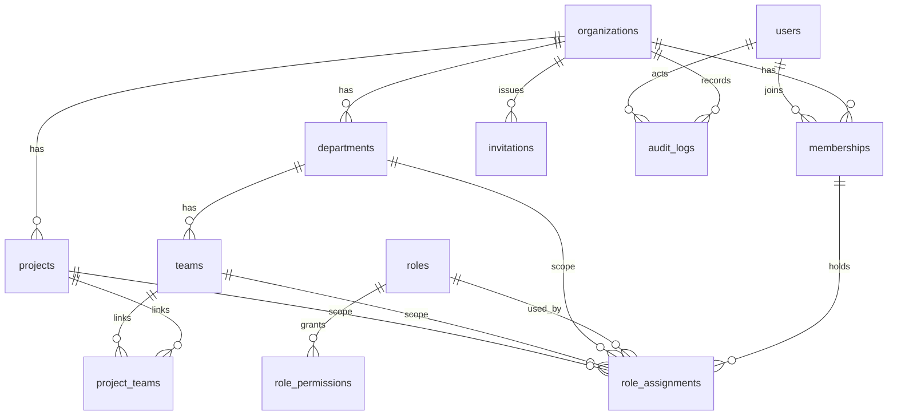

# Entity relationship diagram (Phase 1 schema)

Every tenant table has `org_id NOT NULL`. Child tables reference parents through composite foreign
keys `(org_id, id)` so cross-organization references are impossible at the database level.

Notes
- `roles.org_id IS NULL` marks a system role (`roles_system_has_no_org` check).
- `role_assignments_scope_matches` check: `scope_type` must match exactly one non-null scope column.
- `users` is global (an email belongs to one platform account); access is always via `memberships`.
- Authentication tables (accounts, sessions, verification, MFA) are not part of this schema yet.
- Soft delete: `deleted_at` on organizations, users, departments, teams, projects. Queries must filter it.
