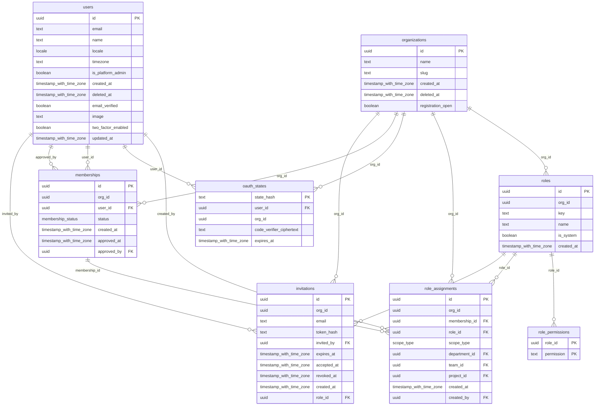
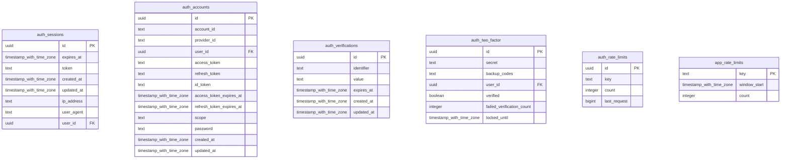
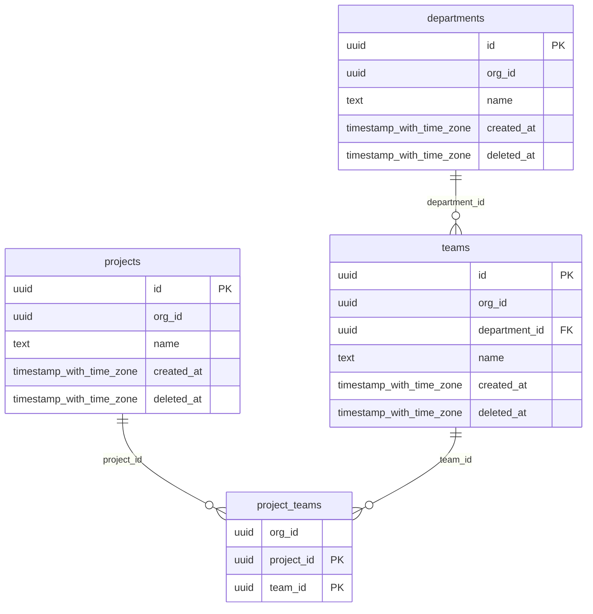
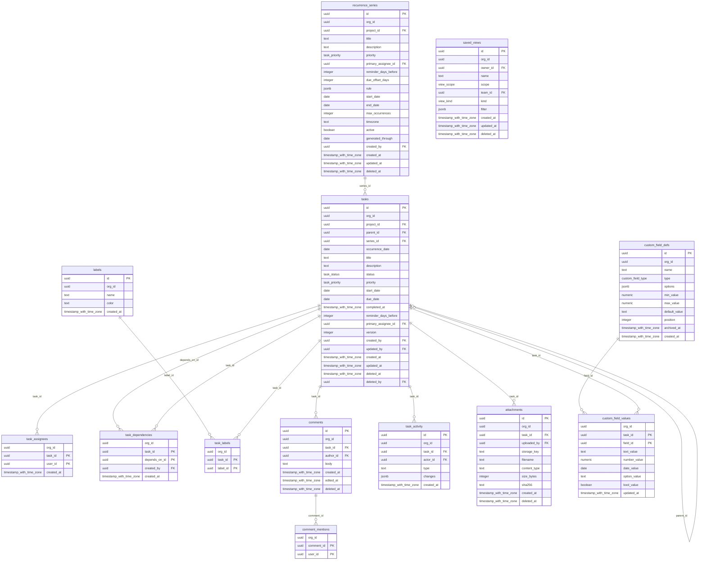
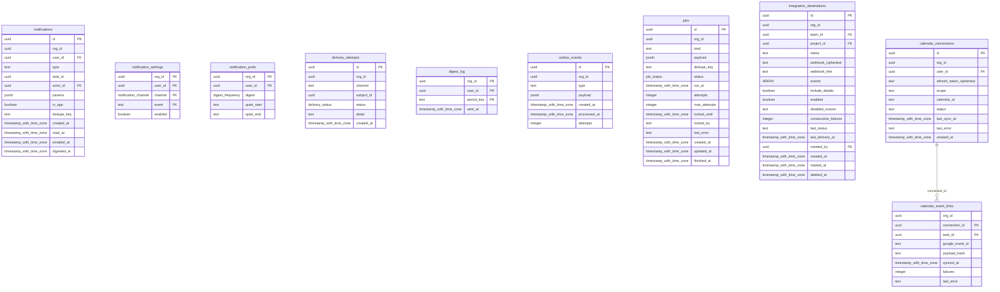
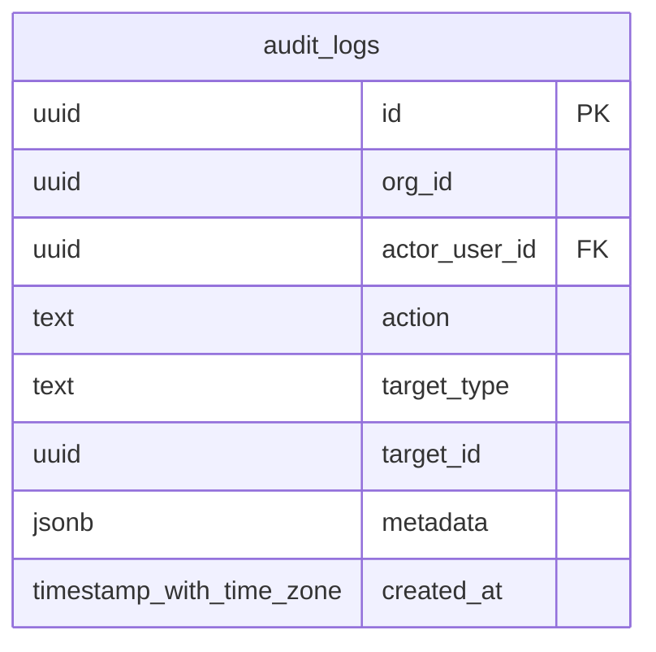

# Entity-relationship diagram

The diagrams below are **generated from a migrated database** (`pnpm docs:erd`), so they show the real schema, not a design intent. Source of truth: `src/db/schema.ts` and `drizzle/*.sql`.

## Conventions

* **Tenancy:** every tenant table has `org_id`, and foreign keys between tenant tables are *composite* on (org_id, id) (the `org_id` half is omitted from the relationship lines), so a row can never reference another organization's row.
* **Row-level security:** every tenant table has RLS enabled and forced, keyed to the transaction-local `app.org_id` setting. Tables without RLS: `users` and the Better Auth tables (`auth_*`), plus the rate-limit counters.
* **Soft delete:** tasks, comments, attachments, saved views, recurrence series, integration destinations, projects, teams, departments, organizations and users carry `deleted_at`; purge rules are in [RETENTION.md](RETENTION.md).
* **Append-only:** `audit_logs` and `task_activity`.
* **Idempotency keys:** `jobs.dedupe_key`, `notifications(user_id, dedupe_key)`, `tasks(series_id, occurrence_date)` (live rows), `calendar_event_links(connection_id, task_id)`.
* **Scoped roles:** `role_assignments` has exactly one of `department_id`/`team_id`/`project_id` (or none for organization scope), each a composite foreign key.
* **Types:** Mermaid has no enum type; PostgreSQL enums (status, priority, job status, locale, …) appear under their type name.

## Where things are

| Area | Tables |
|---|---|
| Identity and tenancy | users, organizations, memberships, invitations, roles, role_permissions, role_assignments |
| Authentication | auth_sessions, auth_accounts, auth_verifications, auth_two_factor, auth_rate_limits, app_rate_limits, oauth_states |
| Structure | departments, teams, projects, project_teams |
| Work | tasks, task_assignees, task_dependencies, labels, task_labels, comments, comment_mentions, task_activity, attachments, recurrence_series, custom_field_defs, custom_field_values, saved_views |
| Notifications and integrations | notifications, notification_settings, notification_prefs, delivery_attempts, digest_log, outbox_events, jobs, integration_destinations, calendar_connections, calendar_event_links |
| Audit | audit_logs |

<!-- GENERATED by `pnpm docs:erd` from a migrated database. Do not edit by hand. -->

42 tables, 74 foreign keys. Composite keys `(org_id, id)` tie every tenant row to its organization; the `org_id` half is omitted from the relationship lines for readability.

### Identity, tenancy and access

Cross-group references: `role_assignments → departments`, `role_assignments → projects`, `role_assignments → teams`.

### Authentication (Better Auth)

Cross-group references: `auth_accounts → users`, `auth_sessions → users`, `auth_two_factor → users`.

### Structure

Cross-group references: `departments → organizations`, `projects → organizations`, `teams → organizations`.

### Work

Cross-group references: `attachments → users`, `comment_mentions → memberships`, `comments → users`, `custom_field_defs → organizations`, `labels → organizations`, `recurrence_series → memberships`, `recurrence_series → users`, `recurrence_series → projects`, `saved_views → organizations`, `saved_views → users`, `saved_views → teams`, `task_activity → users`, `task_assignees → memberships`, `task_dependencies → users`, `tasks → memberships`, `tasks → users`, `tasks → organizations`, `tasks → projects`.

### Notifications, jobs and integrations

Cross-group references: `calendar_connections → memberships`, `calendar_event_links → tasks`, `integration_destinations → users`, `integration_destinations → organizations`, `integration_destinations → projects`, `integration_destinations → teams`, `jobs → organizations`, `notification_prefs → memberships`, `notification_settings → memberships`, `notifications → users`, `notifications → memberships`, `outbox_events → organizations`.

### Audit

Cross-group references: `audit_logs → users`, `audit_logs → organizations`.

