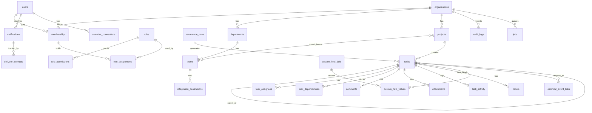

# Phase 0 — Repository Inspection & Technical Proposal

วันที่: 2026-10-17 · สถานะ: **ข้อเสนอเพื่อรอการอนุมัติ — ยังไม่มีการเขียนโค้ดแอปพลิเคชัน**

## 1. ผลการตรวจ repository

| รายการ | ผลที่ตรวจพบ |
|---|---|
| Git | branch `master` ยังไม่มี commit เลย (greenfield) |
| ไฟล์ในโปรเจกต์ | ไม่มี (มีแต่ `.git`) |
| Remote | `origin` → `Pittzaa/Task-detect` |
| Toolchain ใน sandbox | Node v22.22.0, npm 10.9.4, pnpm 10.28.0, Python 3.13 |
| Framework / tests / deploy config | ไม่มี — ไม่มีอะไรให้ต้องรักษาหรือ migrate |

**สรุป:** เป็นโปรเจกต์ใหม่ทั้งหมด จึงเลือก stack ได้อิสระ ไม่มีฟังก์ชันเดิมที่ต้อง preserve

## 2. สถานะการยืนยันข้อมูลผู้ให้บริการ (สำคัญ)

Prompt กำหนดให้ตรวจเอกสารปัจจุบันก่อนตัดสินใจ แต่ session นี้ **เข้า `vercel.com` และ `neon.com` ไม่ได้** (proxy ตอบ 403 `connect_rejected`) ข้อมูลด้านล่างจึงมาจาก **ผลค้นหาเว็บ (รองรับด้วยหน้าเอกสารที่ถูกอ้างในผลค้นหา แต่ไม่ได้เปิดอ่านเอง)** ทุกข้อที่ทำเครื่องหมาย ⚠️ ต้องยืนยันกับเอกสารหลักก่อนเริ่ม implement

| หัวข้อ | สิ่งที่พบ | สถานะ |
|---|---|---|
| Vercel Blob private | Private Blob GA ทุก plan เมื่อ 2026-06-30; SDK `@vercel/blob` ≥ 2.3; อ่านไฟล์ต้องมี token และส่งผ่าน `get()` ใน Function; มี signed URL แบบหมดอายุ; เปลี่ยน access mode ของ store หลังสร้างไม่ได้ | ⚠️ ไม่ได้เปิดอ่านหน้าหลัก; ขนาดไฟล์สูงสุด/ราคา **ไม่ทราบ** |
| Vercel Cron | Hobby: รันได้วันละ 1 ครั้ง (เวลาคลาดเคลื่อนภายในชั่วโมง); Pro/Enterprise: ถี่สุดทุก 1 นาที; cron ใช้ Functions และคิดค่า usage ตามปกติ | ⚠️ **แหล่งข้อมูลขัดแย้งเรื่องจำนวน cron jobs** (100/โปรเจกต์ vs 2 Hobby / 40 Pro) และไม่พบข้อมูลการ retry เมื่อล้มเหลว |
| Neon history window | Free: 6 ชม.; Launch: default 1 วัน สูงสุด 7 วัน; Scale: default 1 วัน สูงสุด 30 วัน; ค่าเก็บ history $0.20/GB-เดือน (Launch/Scale) | ⚠️ มีหน้าเก่าระบุ Free = 24 ชม. จึงขัดแย้งกัน; **ยังไม่ทราบว่า Neon มี "daily automated backup" แยกจาก history window หรือไม่** |
| Auth | แหล่งส่วนใหญ่แนะนำ Better Auth สำหรับโปรเจกต์ใหม่ (มี plugin: OAuth, 2FA, organization, passkey); มีรายงานว่า Auth.js ไปอยู่กับทีม Better Auth | ⚠️ เป็นบล็อกเปรียบเทียบ ไม่ใช่เอกสารทางการ; **ยังไม่ยืนยัน** Google + 2FA + session revoke ในเอกสารทางการ |
| Job/queue | Inngest (step + retry + sleep), Upstash QStash (HTTP queue + retry + DLQ + cron), Vercel Workflow | ⚠️ **ไม่พบราคา/ลิมิตจริงของทั้งสามตัว** |

ราคาและ plan limits ที่ไม่ระบุข้างต้น = **ไม่ทราบ** จะไม่เดาตัวเลข

## 3. สถาปัตยกรรมที่เสนอ

### 3.1 Stack

| ชั้น | เสนอ | เหตุผล / ทางเลือก |
|---|---|---|
| Framework | Next.js (App Router) + TypeScript strict, pnpm | เหมาะกับ Vercel; ไม่มีโค้ดเดิม |
| DB | Neon Postgres (**ตายตัว**) | pooled connection สำหรับ runtime, direct connection สำหรับ migration |
| ORM/Migration | Drizzle ORM + drizzle-kit (SQL migrations ที่ review ได้) | ทางเลือก: Prisma — ผมเลือก Drizzle เพราะเขียน SQL constraint/RLS/CTE (dependency cycle) ตรงๆ ได้ง่ายกว่า |
| Email | Resend API (**ตายตัว**) | + template ที่ localize ได้ |
| Hosting | Vercel (**ตายตัว**) | ต้องใช้ **Pro** หาก cron ต้องถี่กว่าวันละครั้ง ⚠️ |
| Auth | Better Auth (แนะนำ) | ทางเลือก: Auth.js (ต้องเขียน MFA/org เอง), Clerk (SaaS — lock-in/ค่าใช้จ่าย) — **ต้องยืนยันเอกสารก่อนล็อกผล** |
| Attachments | Vercel Blob แบบ private + route ดาวน์โหลดที่ authorize ทุกครั้ง | fallback: S3-compatible (R2/S3) ถ้าเงื่อนไขขนาด/ราคาไม่ผ่าน; ไม่มี malware scan ในตัว (ต้องบันทึกเป็น known limitation) |
| Background jobs | **Durable job table ใน Postgres (outbox + lease + attempts + idempotency key)** เป็นแกนความน่าเชื่อถือ และใช้ Vercel Cron เป็นเพียงตัว "ปลุก dispatcher" | ทางเลือก: Inngest (เพิ่ม provider, retry/observability พร้อม) — **รอคุณตัดสินใจ** (ดูข้อ 6) |
| Real-time | v1: signal-only events (บอกว่า "task X เปลี่ยน") ผ่าน managed provider (เช่น Ably/Pusher) แล้ว client ดึงข้อมูลจริงผ่าน API ที่ authorize; ระยะแรกใช้ polling/SWR revalidate ก็ได้ | ไม่ส่งเนื้อหา task ผ่านช่อง real-time เพื่อไม่ให้ bypass authorization; SSE บน serverless มีข้อจำกัดด้านระยะเวลา |
| Monitoring | เลื่อนไป Phase 5 (Sentry หรือ Vercel Observability) | ใส่เมื่อมีเหตุผลรองรับ |
| i18n | `next-intl` + ไฟล์ message `th`/`en`; enum เก็บเป็นค่าคงที่ ไม่ขึ้นกับภาษา | |
| Test | Vitest (unit/integration), Playwright (e2e — Chromium มีใน sandbox), Neon branch หรือ Postgres container สำหรับ DB test | |

### 3.2 การแยกชั้นโค้ด

```
src/
  domain/        กติกาล้วนๆ (status transitions, recurrence, cycle detection) — ไม่ import DB/HTTP
  authz/         permission catalog + evaluator + guard
  data/          repositories — รับ TenantContext บังคับ ไม่มีทางเรียกโดยไม่ระบุ org
  services/      use-case (transaction, audit, outbox)
  integrations/  resend, discord, google-calendar, blob
  jobs/          handlers (idempotent, re-check permission)
  app/           routes/UI เท่านั้น
```

### 3.3 Tenant isolation (ป้องกัน 2 ชั้น)

1. **Application layer:** ทุก repository method ต้องรับ `TenantContext { orgId, userId }` ที่ได้จาก session + membership ในฝั่ง server เท่านั้น ห้ามใช้ ID จาก client เป็นหลักฐานสิทธิ์ ตรวจ resource ทุกตัวว่าอยู่ใน `orgId` เดียวกัน
2. **Database layer (defense in depth):** composite FK `(org_id, id)` เพื่อกัน row ข้าม tenant และพิจารณา Postgres RLS ด้วย `SET LOCAL app.org_id` ต่อ transaction — ⚠️ ต้องทดสอบว่าทำงานถูกต้องกับ Neon pooled connection ก่อนยืนยัน
3. มี test ที่พยายามอ่าน/เขียนข้าม org ในทุก entity (นับเป็น gate ของ Phase 1)

## 4. โมเดลข้อมูลเบื้องต้น



ประเด็นออกแบบหลัก (รายละเอียดจะอยู่ใน `docs/ERD.md` ใน Phase 1):

- **ทุกตารางข้อมูลธุรกิจมี `org_id NOT NULL`** + unique/FK แบบ composite
- **RBAC:** `roles` (system role `org_id IS NULL`, custom role ผูก org) → `role_permissions` → `role_assignments(membership_id, role_id, scope_type, scope_id)` — แยก "บทบาท" ออกจาก "ขอบเขต"; มี CHECK/trigger ตรวจว่า `scope_id` ชี้ entity ที่มีอยู่จริงและอยู่ใน org เดียวกัน
- **Dependency cycle:** ตรวจใน transaction ด้วย recursive CTE + advisory lock ต่อ org/project ป้องกัน race
- **Dates:** `timestamptz` (UTC) สำหรับช่วงเวลา, `date` สำหรับวันที่ไม่มีเวลา, `users.timezone` (IANA)
- **Recurrence:** เก็บ rule + `occurrence_key` unique `(series_id, occurrence_date)` กันสร้างซ้ำเมื่อ job รันซ้ำ
- **Soft delete:** `deleted_at`, `deleted_by`; query ทุกตัวกรองโดยค่าเริ่มต้น
- **Audit:** append-only (REVOKE UPDATE/DELETE จาก role ของแอป), redact field ลับ, purge ที่ 90 วันด้วย job เฉพาะ
- **Secrets:** webhook URL และ OAuth token เข้ารหัสด้วย key ใน env (app-level encryption) — ต้องเลือกวิธี/การหมุน key (ดูข้อ 6)

## 5. ข้อเสนอ RBAC (ร่าง — ต้องให้คุณยืนยัน)

- **ขอบเขต (scope):** organization > department > team / project > task (task ใช้เฉพาะกรณีที่จำเป็น เช่น guest-share ในอนาคต — v1 อาจมีแค่ 4 ระดับแรก)
- **การรวมสิทธิ์:** สิทธิ์ที่มีผล = **union ของ role assignments ทุกอันที่ครอบคลุม resource นั้น** (scope กว้างไหลลงมาหา scope แคบ) ไม่มี explicit deny ใน v1 เพื่อความเรียบง่ายและตรวจสอบได้ ไม่พบ assignment ที่เกี่ยวข้อง = ปฏิเสธ
- **superadmin:** ระดับแพลตฟอร์ม จัดการ organization/ผู้ใช้ข้าม tenant ได้ แต่ **ไม่เห็นเนื้อหา task/ไฟล์ของ org โดยปริยาย** (ต้อง impersonate/เข้า org อย่างมีบันทึก audit) — ⚠️ ต้องให้คุณตัดสินใจ
- **orgadmin:** สิทธิ์ทั้งหมดภายใน org ของตน; จัดการสมาชิก, role, integration, custom field; ลบถาวรได้ตามนโยบาย retention
- **manager / member / viewer:** manager = จัดการ task/สมาชิกใน scope ที่ถูกกำหนด; member = สร้าง/แก้ task ที่เกี่ยวข้อง; viewer = อ่านอย่างเดียว
- **custom:** เลือกชุด permission จาก catalog (`task.create`, `task.read`, `task.update`, `task.delete`, `task.assign`, `task.change_status`, `task.manage_dependencies`, `project.manage_members`, ฯลฯ) — catalog เต็มจะอยู่ใน `docs/RBAC.md`
- ตาราง RBAC matrix + test เชิงบวก/ลบ เป็น deliverable ของ Phase 1

## 6. การตัดสินใจที่ยังเปิดอยู่ (ต้องการคำตอบจากคุณ)

ผมเสนอค่าเริ่มต้นไว้แล้ว หากไม่ตอบ ผมจะใช้ค่าที่แนะนำ ยกเว้นข้อ 1–3 ซึ่งกระทบ plan/ค่าใช้จ่ายจึงอยากให้ยืนยัน

| # | คำถาม | ค่าแนะนำ |
|---|---|---|
| 1 | แผน Vercel / Neon ที่จะใช้ (Hobby/Pro, Free/Launch/Scale)? | Vercel Pro (cron ถี่กว่าวันละครั้ง), Neon Launch ขึ้นไป — ⚠️ ราคา/เงื่อนไขการใช้เชิงพาณิชย์ของ Hobby ต้องยืนยัน |
| 2 | Job system: DB queue + Vercel Cron เอง หรือเพิ่ม Inngest/QStash? | DB queue + Cron (ไม่เพิ่ม provider; ต้องเขียน retry/lease เอง) |
| 3 | Real-time: ใช้ managed provider (Ably/Pusher) ตั้งแต่ Phase 2 หรือเริ่มด้วย polling? | polling ก่อน, เพิ่ม provider ใน Phase 3–4 ถ้าจำเป็น |
| 4 | Auth library: Better Auth ตามที่เสนอ ตกลงไหม (หลังผมยืนยันเอกสาร)? | Better Auth |
| 5 | superadmin เห็นเนื้อหา task ของ org หรือไม่? | ไม่เห็นโดยปริยาย |
| 6 | Daily backup: Neon history window ไม่เท่ากับ daily backup — จะเพิ่ม `pg_dump` รายวันไปเก็บที่ object storage แยก (เช่น R2/S3) หรือไม่? | เพิ่ม (ต้องมี provider/credential เพิ่ม) |
| 7 | ชนิด/ขนาดไฟล์แนบสูงสุดที่ต้องการ? | เสนอ 25 MB/ไฟล์ allow-list (pdf, png, jpg, docx, xlsx, txt, csv) — ปรับได้ |
| 8 | ขนาดผู้ใช้/จำนวน task ที่คาดหวัง (กระทบ index, polling, ราคา)? | ไม่ทราบ — โปรดระบุคร่าวๆ |
| 9 | มี domain, Google Cloud project (OAuth), Discord server สำหรับทดสอบ หรือยัง? | ไม่ทราบ — จำเป็นต่อการทดสอบ integration จริง |

## 7. ความเสี่ยง

| ความเสี่ยง | ผลกระทบ | แผนรับมือ |
|---|---|---|
| ข้อมูล plan/ราคา/limit ยังไม่ยืนยันกับเอกสารหลัก | เลือก stack ผิด/งบบานปลาย | ยืนยันก่อน Phase 1 (ต้องเปิดให้เข้าถึงโดเมนเหล่านั้น หรือคุณส่งข้อมูลให้) |
| Cross-tenant leakage | ร้ายแรงสุด | scoped repositories + composite FK + (RLS) + test ทุก entity |
| Cron ไม่การันตี exactly-once / อาจล้มเหลว | แจ้งเตือน/คาบ recurring ซ้ำหรือหาย | job table + idempotency key + lease + dead-letter + monitor job ค้าง |
| RLS กับ pooled connection | policy ไม่ทำงานตามคาด | ทดสอบจริงบน Neon branch ก่อนพึ่งพา |
| Google token/Discord webhook รั่ว | ผู้โจมตีส่งข้อความ/อ่านปฏิทิน | เข้ารหัส at-rest, ไม่ส่งกลับ client, ไม่ลง log |
| ไม่มี malware scan ไฟล์แนบ | ไฟล์อันตรายถูกอัปโหลด | allow-list, `Content-Disposition: attachment`, ไม่ render inline; บันทึกเป็น known limitation |
| ขอบเขตกว้างมาก | ส่งช้า/คุณภาพตก | แบ่ง phase ที่ตรวจรับได้ ไม่ทำ big-bang |
| Sandbox นี้ออกเน็ตได้จำกัด | ทดสอบ Vercel/Neon/Resend/Google/Discord จริงไม่ได้ | แยก "ทดสอบจริง" ออกจาก "ทดสอบด้วย mock" ในรายงาน และแจ้งขั้นตอนที่คุณต้องทำเอง |

## 8. เกณฑ์ตรวจรับรายเฟส (ย่อ)

| Phase | ส่งมอบหลัก | เกณฑ์ผ่านขั้นต่ำ |
|---|---|---|
| 1 Foundation | scaffold, env validation, migrations, schema แกน, auth + approval lifecycle, scoped RBAC, tenant context | lint/typecheck/build ผ่าน; test ข้าม org ล้มเหลวตามคาดทุก entity; pending user เข้าถึง API ไม่ได้; migration ขึ้น/ลงบน DB ว่างได้ |
| 2 Core | dept/team/project/task/subtask/comment/label/attachment/dependency/activity; List, Kanban, My Tasks | status transition + cycle detection มี unit test; IDOR test; ดาวน์โหลดไฟล์ต้อง authorize |
| 3 Productivity | search, filters, saved views, custom fields, bulk, Calendar, Dashboard, Gantt, recurrence, time zone, i18n | search ไม่รั่วข้อมูล; bulk มี per-item result; recurrence ไม่ซ้ำเมื่อ retry; ทดสอบ DST; test th/en |
| 4 Notify & Integrations | in-app, email, digest, Discord, Google Calendar one-way, job ที่ทนต่อ retry | ตรวจสิทธิ์ซ้ำตอนส่ง; ไม่มีซ้ำ; one-way sync test; ทดสอบจริงเฉพาะที่มี credential |
| 5 Ops | audit 90 วัน, purge, backup + **restore test จริง**, monitoring, security review, deployment docs, readiness report | restore สำเร็จและบันทึกผล; รายงานระบุ verified / partially / unverified และ go-live blockers |

เอกสารที่ต้องมีตามข้อ 18 ของ prompt จะถูกสร้างและอัปเดตตามเฟส (ยังไม่สร้างใน Phase 0 นอกจากไฟล์นี้)

## 9. สิ่งที่ยังไม่ได้ทำ (ตั้งใจ)

ไม่มีการ scaffold โปรเจกต์ ติดตั้ง dependency หรือสร้าง schema จริง รอการอนุมัติข้อเสนอนี้ก่อนตาม prompt
